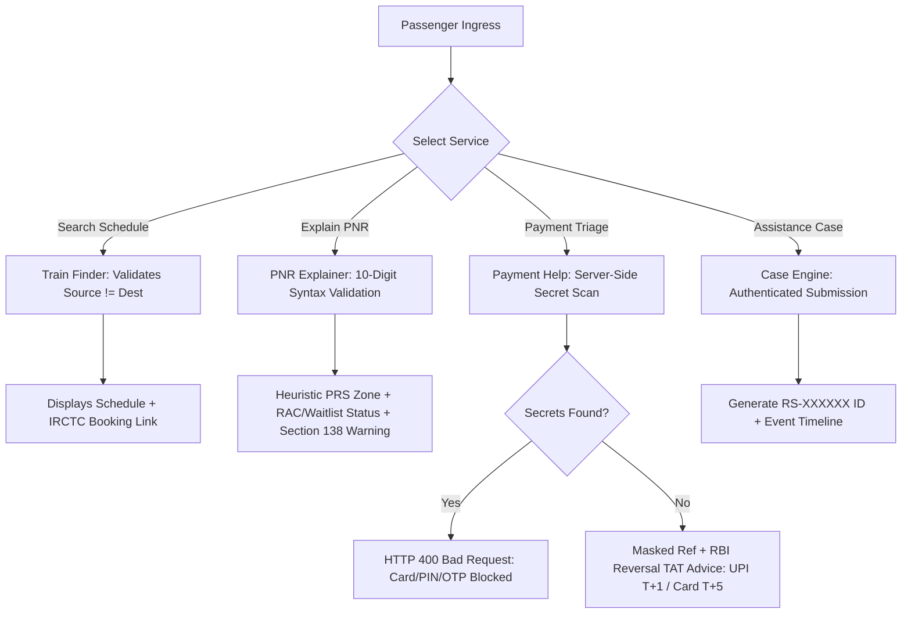
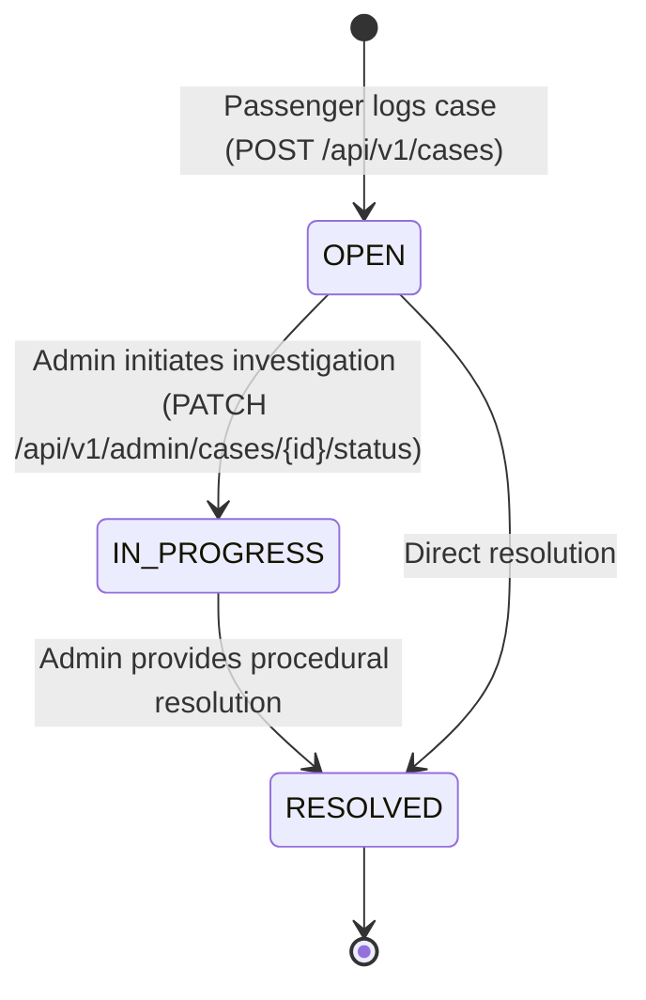
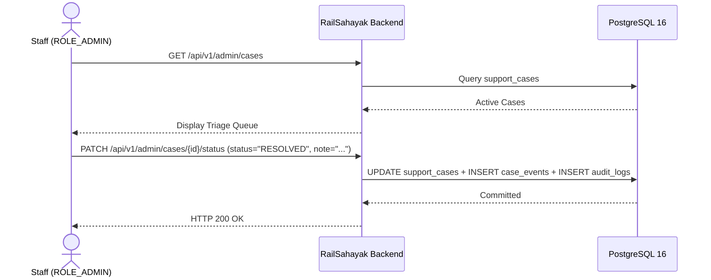
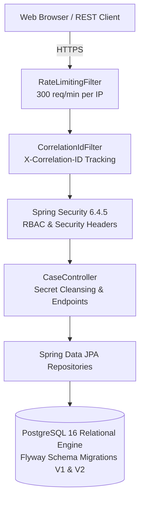

# RailSahayak

> **An Independent Passenger Assistance & Railway Service Support Prototype**  
> *Prepared for Exploratory Technical Review by Indian Railways, IRCTC, and CRIS Stakeholders*

[](https://github.com/rajivsharma8757/RailSahayak/actions/workflows/ci.yml)
[](https://railsahayak-backend.onrender.com)
[](https://adoptium.net/)
[](https://spring.io/projects/spring-boot)
[](https://www.postgresql.org/)
[](LICENSE)
[](docs/TESTING.md)

> 🚀 **Live Cloud Deployment:** [https://railsahayak-backend.onrender.com](https://railsahayak-backend.onrender.com)  
> 👤 **Instant Public Passenger Evaluation:** Username `passenger` / Password `PassengerDemo123!`  
> 🔒 **Administrative Evaluation:** Credentials provided privately upon request to `rajivkumarsharma200@gmail.com`  
> 👨‍💻 **Developer & Maintainer:** Rajiv Sharma, third-year B.Tech Computer Science and Engineering student at Maharishi Markandeshwar (Deemed to be University), Mullana, Ambala, Haryana

---

## 1. Project Title & Concise Introduction

**RailSahayak** is an independent, evidence-backed software prototype designed to provide structured pre-triage assistance and plain-language procedural guidance for Indian Railways passengers. Engineered by Rajiv Sharma, a third-year B.Tech Computer Science and Engineering student at Maharishi Markandeshwar (Deemed to be University), Mullana, Ambala, Haryana, and built with Spring Boot 3.4.5, Java 21 LTS, and PostgreSQL 16, RailSahayak translates complex ticketing rules, decodes reservation statuses, explains bank settlement timelines for failed digital payments, and provides an isolated local case workflow engine for passenger inquiries.

> **INSTITUTIONAL DISCLAIMER:** RailSahayak is an independently developed research and engineering prototype. It is **not** an officially endorsed application of the Ministry of Railways, IRCTC, CRIS, or RailMadad. It does not perform live ticket bookings, does not query live production PRS databases, and does not initiate banking transfers. All interactions with official railway services are provided via authoritative outbound reference links to [IRCTC](https://www.irctc.co.in/), [CRIS PRS](https://indianrail.gov.in/), and [RailMadad](https://railmadad.indianrailways.gov.in/).

---

## 2. Project Purpose & Passenger Problem Statement

According to the Ministry of Railways Annual Statistical Statement, Indian Railways transports over 6.7 billion passengers annually, with the computerised Passenger Reservation System (PRS) handling 1.5 to 2.0 million reserved tickets daily. At this immense scale, travelers routinely experience friction across five core operational categories:

1. **Reservation Ambiguity:** Confusion over waitlist confirmation hierarchies (GNWL vs. RLWL vs. PQWL), charting deadlines, and the strict statutory prohibition under Section 138 of The Railways Act, 1989 against boarding with fully waitlisted e-tickets.
2. **Payment Reconciliation Uncertainty:** Acute passenger anxiety during Tatkal booking timeouts when money is debited from bank accounts without a confirmed PNR, frequently causing duplicate panic bookings.
3. **Portal Fragmentation:** Cognitive overhead navigating disconnected digital touchpoints across IRCTC, indianrail.gov.in, NTES, and RailMadad.
4. **Grievance Pipeline Saturation:** Routine informational queries flooding the RailMadad 139 helpline, diverting staff attention from critical onboard emergencies (hygiene, medical, electrical).
5. **Citizen Privacy Risks:** Unassisted passengers publicly posting screenshots of banking SMS alerts, full 10-digit PNRs, and transaction IDs on social media platforms, exposing themselves to phishing syndicates.

RailSahayak addresses these challenges by serving as an intelligent upstream pre-triage advisory layer.

---

## 3. Key Capabilities

- **Smart Train Finder:** Deterministic exploration of high-density trunk routes (e.g. New Delhi–Patna, New Delhi–Mumbai) with class filtering and authoritative IRCTC booking handoff.
- **PNR Explainer Engine:** Offline 10-digit PNR validation, first-digit PRS cluster heuristic derivation, plain-language status decoding (CNF, RAC, GNWL, PQWL), and prominent Section 138 statutory boarding warnings.
- **Payment Help Diagnoser:** Zero-trust financial triage evaluating UPI, Card, and Net Banking issues. Scrubs payment reference strings to reject 16-digit card patterns and security keywords (CVV, OTP, PIN, password), masks valid references (e.g. `UPI****098`), and provides official Reserve Bank of India (RBI) Turnaround Time (TAT) auto-reversal guidance.
- **Support Case Workflow Engine:** Authenticated multi-tenant case tracking (`RS-XXXXXX` IDs), role-based isolation between passengers and staff, and immutable timeline event logging.
- **Admin Management Console:** Staff triage queue (`ROLE_ADMIN`) enforcing state machine transitions (`OPEN` &rarr; `IN_PROGRESS` &rarr; `RESOLVED`) and writing dual audit records.
- **Defensive Edge Architecture:** In-memory sliding-window rate limiting (300 req/min per IP), trusted reverse proxy verification, and request correlation tracking (`X-Correlation-ID`) across logs.

---

## 4. Feature Status Matrix

| Feature / Capability | Operational Status | Technical Implementation | Railway Boundary |
| :--- | :--- | :--- | :--- |
| **Schedule Route Search** | **Implemented** | Deterministic static schedules in Spring Boot controller | Refers passenger to `irctc.co.in` for booking |
| **PNR Format Validation** | **Implemented** | Strict 10-digit numeric regex and validation | Validates syntax; rejects malformed inputs |
| **PRS Zone Heuristic** | **Implemented** | Offline first-digit routing convention lookup | Explicitly labeled as heuristic; no CRIS live query |
| **Payment Secret Cleansing** | **Implemented** | Server-side regex pattern and keyword filter | Rejects cards/PINs/OTPs; masks safe references |
| **RBI Reversal TAT Guidance** | **Implemented** | RBI Circular DPSS.CO.PD No.629/02.01.014/2019-20 | Explains UPI T+1, Card T+5 bank auto-reversal |
| **Support Case Tracking** | **Implemented** | PostgreSQL 16 persistence with Flyway migrations | Local prototype cases; refers to RailMadad for emergencies |
| **Dual Audit Logging** | **Implemented** | Atomic `CaseEvent` and `AuditLog` row generation | Internal governance trail for compliance |
| **Live Ticket Booking** | *Unavailable* | Excluded from scope (out of scope) | Requires commercial merchant agreement with IRCTC |
| **Live PNR Status Query** | *Planned* | Scoped for future authorized stage (MoU Gate 2) | Requires formal CRIS PRS API licensing |
| **Live Train GPS Tracking** | *Unavailable* | Excluded from scope | Handled authoritatively by CRIS NTES / RTIS |

---

## 5. Architectural Interface Specifications

The interface specifications below illustrate the functional layout and user workflows implemented in `src/main/resources/static/index.html`:

```
+----------------------------------------------------------------------------------------------------+
|  RailSahayak — Passenger Guidance & Service Support Prototype                                      |
+----------------------------------------------------------------------------------------------------+
|  [ Train Search ]        [ PNR Explainer ]        [ Payment Help ]        [ Support Cases ]        |
+----------------------------------------------------------------------------------------------------+
|  SMART TRAIN FINDER                                                                                |
|  From: [ NDLS ]    To: [ PNBE ]    Date: [ 2026-10-25 ]    Class: [ 3A ]    [ Search Trains ]     |
|                                                                                                    |
|  Results:                                                                                          |
|  * 12310 Patna Tejas Rajdhani Express | Dep: 17:10 -> Arr: 05:15 (12h 05m) | [1A, 2A, 3A]          |
|  * 12394 Sampoorna Kranti Express     | Dep: 17:30 -> Arr: 06:50 (13h 20m) | [1A, 2A, 3A, SL]      |
|                                                                                                    |
|  [!] DISCLAIMER: Advisory schedule only. Execute official bookings at https://www.irctc.co.in/    |
+----------------------------------------------------------------------------------------------------+
```

Detailed visual cards and architectural mockups are documented in [`docs/RailSahayak_Comprehensive_Stakeholder_Proposal.pdf`](docs/RailSahayak_Comprehensive_Stakeholder_Proposal.pdf) (Section 13).

---

## 6. Passenger Journey Workflow



---

## 7. Complaint Lifecycle Workflow



---

## 8. Administrative Workflow



---

## 9. Architecture Diagram



---

## 10. Technology Stack

- **Runtime:** Eclipse Temurin OpenJDK Java 21 LTS (64-bit)
- **Framework:** Spring Boot 3.4.5 (`spring-boot-starter-web`, `validation`, `data-jpa`, `security`, `test`)
- **Database:** PostgreSQL 16 Relational Engine
- **Schema Management:** Flyway Migration Framework 10.20.1
- **Build System:** Apache Maven 3.9+
- **Containerization:** Multi-stage Dockerfile & Docker Compose
- **Continuous Integration:** GitHub Actions (`.github/workflows/ci.yml`)

---

## 11. Repository Structure

```
RailSahayak/
├── .github/
│   └── workflows/
│       └── ci.yml               # Automated GitHub Actions test pipeline
├── docs/
│   ├── ARCHITECTURE.md          # Technical architecture & component specification
│   ├── WORKFLOWS.md             # End-to-end user journeys & state machine diagrams
│   ├── API_REFERENCE.md         # Full REST API catalog with request/response examples
│   ├── SECURITY.md              # Threat model, defensive controls & DPDP alignment
│   ├── DEPLOYMENT.md            # Local Windows, Docker Compose & Cloud setup guides
│   ├── TESTING.md               # Automated test harness & 29-test coverage report
│   ├── RailSahayak_Stakeholder_Presentation.pptx   # Approved 11-slide deck
│   ├── RailSahayak_Stakeholder_Presentation.pdf    # Matching presentation export
│   └── RailSahayak_Comprehensive_Stakeholder_Proposal.pdf # 31-page technical proposal
├── scripts/
│   ├── generate_comprehensive_proposal.py  # ReportLab 2-pass proposal compiler
│   ├── generate_proposal_charts.py         # 300-DPI visual chart generator
│   └── scan_secrets.py                     # Security audit secret scanner
├── src/
│   ├── main/
│   │   ├── java/in/railsahayak/
│   │   │   ├── AuditLog.java               # JPA AuditLog entity
│   │   │   ├── AuditLogRepository.java     # AuditLog repository
│   │   │   ├── CaseController.java         # Core REST API controller & secret filter
│   │   │   ├── CaseEvent.java              # JPA CaseEvent timeline entity
│   │   │   ├── CaseEventRepository.java    # CaseEvent repository
│   │   │   ├── CorrelationIdFilter.java    # MDC correlation ID filter
│   │   │   ├── GlobalExceptionHandler.java # Zero-leakage sanitized error handler
│   │   │   ├── RailSahayakApplication.java # Spring Boot entrypoint
│   │   │   ├── RateLimitingFilter.java     # In-memory sliding window rate limiter
│   │   │   ├── SecurityConfig.java         # Spring Security RBAC & HTTP headers
│   │   │   ├── SupportCase.java            # JPA SupportCase entity
│   │   │   └── SupportCaseRepository.java  # SupportCase repository
│   │   └── resources/
│   │       ├── application.yml             # Externalized application configuration
│   │       ├── db/migration/
│   │       │   ├── V1__create_tables.sql   # Flyway V1 schema migration DDL
│   │       │   └── V2__add_performance_indexes.sql # Flyway V2 performance indexes
│   │       └── static/
│   │           └── index.html              # Embedded interactive client application
│   └── test/java/in/railsahayak/
│       └── RailSahayakApplicationTests.java # 29 automated JUnit integration tests
├── .env.example                 # Configuration template with placeholders
├── .gitignore                   # Hardened git ignore rules
├── CONTRIBUTING.md              # Contribution standards & PR workflow
├── docker-compose.yml           # Full-stack application + PostgreSQL setup
├── Dockerfile                   # Multi-stage production container build
├── LICENSE                      # MIT Open-Source License
├── pom.xml                      # Maven project descriptor
└── README.md                    # This comprehensive project documentation
```

---

## 12. Local Setup Instructions for Windows

### Prerequisites
- Install **Java 21 LTS** (e.g. Eclipse Temurin 21).
- Install **Apache Maven 3.9+**.
- Ensure **PostgreSQL 16** is running locally on port 5432.

### Step-by-Step Launch
1. Clone the repository:
   ```powershell
   git clone https://github.com/rajivsharma8757/RailSahayak.git
   cd RailSahayak
   ```
2. Initialize database:
   ```sql
   CREATE USER railsahayak WITH PASSWORD 'railsahayak_dev_only';
   CREATE DATABASE railsahayak OWNER railsahayak;
   ```
3. Run automated test suite:
   ```powershell
   mvn clean test
   ```
4. Start the application:
   ```powershell
   mvn spring-boot:run
   ```
5. Open your browser and navigate to: `http://localhost:8081/index.html`

---

## 13. Prerequisites & Environment Variables

| Variable | Default Value | Description |
| :--- | :--- | :--- |
| `PORT` | `8081` | HTTP web server port |
| `DB_URL` | `jdbc:postgresql://localhost:5432/railsahayak` | PostgreSQL JDBC connection URL |
| `DB_USERNAME` | `railsahayak` | Database user account |
| `DB_PASSWORD` | `railsahayak_dev_only` | Database user password |
| `DEMO_PASSENGER_PASSWORD` | `PassengerDemo123!` (or env override) | Password for demo passenger account |
| `DEMO_ADMIN_PASSWORD` | *[Secure / Environment specific]* | Private administrator evaluation credential |
| `RAILSAHAYAK_RATE_LIMIT_LIMIT_PER_MINUTE` | `300` | Sliding window rate limit threshold |
| `RAILSAHAYAK_RATE_LIMIT_TRUST_FORWARDED_FOR` | `false` | Enable only behind trusted reverse proxy |

---

## 14. Docker & PostgreSQL Setup

Run both the Spring Boot backend and PostgreSQL database using Docker Compose:

```bash
# Start all services in the background
docker compose up -d --build

# Verify container health
docker compose ps

# Access application
curl http://localhost:8081/api/v1/health
```

---

## 15. Maven Build & Test Commands

```bash
# Run integration tests
mvn clean test

# Package standalone executable JAR
mvn clean package -DskipTests

# Run packaged application
java -jar target/railsahayak-backend-0.1.0.jar
```

---

## 16. API Documentation Summary

See [`docs/API_REFERENCE.md`](docs/API_REFERENCE.md) for full endpoint specifications.

| Method | Endpoint | Access | Purpose |
| :--- | :--- | :--- | :--- |
| `GET` | `/api/v1/health` | Public | Service health & rate-limiter status probe |
| `POST` | `/api/v1/train-search` | Authenticated | Deterministic trunk route schedule search |
| `POST` | `/api/v1/pnr-guide/explain` | Authenticated | PNR 10-digit validation, zone heuristic & rule explainer |
| `POST` | `/api/v1/payment-help/diagnose` | Authenticated | Zero-trust payment secret cleansing & RBI TAT guidance |
| `POST` | `/api/v1/cases` | Authenticated | Create support case with `RS-XXXXXX` tracking ID |
| `GET` | `/api/v1/cases` | Authenticated | List support cases belonging to authenticated user |
| `PATCH`| `/api/v1/admin/cases/{id}/status` | Admin | Transition case status (`OPEN` &rarr; `IN_PROGRESS` &rarr; `RESOLVED`) |

---

## 17. Database Schema & Migration Architecture

Schema migrations are strictly version-controlled with Flyway:
- **`V1__create_tables.sql`:** Creates `support_cases`, `case_events`, and `audit_logs` tables with primary keys, unique constraints, and foreign key cascades.
- **`V2__add_performance_indexes.sql`:** Appends B-tree performance indexes on foreign keys (`case_events.case_id`), status filters (`support_cases.status`), and temporal sorting columns (`created_at`).

---

## 18. Security & Privacy Considerations

- **Server-Side Secret Filtering:** Payment reference inputs are scanned with regex (`(?i)\b(\d{4}[- ]?){3}\d{4}\b|\b(cvv|otp|pin|password)\b`) to abort requests containing payment card PANs or secret keywords.
- **Data Minimisation:** Unmasked financial credentials are never persisted to disk or emitted in logs.
- **Role Isolation:** Staff administrative endpoints (`/api/v1/admin/**`) require `ROLE_ADMIN`; unauthorized access returns HTTP 403 Forbidden.
- **Zero-Leakage Error Handling:** `GlobalExceptionHandler` logs full exception traces internally while returning sanitized correlation IDs to clients.
- **DPDP Act 2023 Principles:** Aligns with purpose limitation, data minimisation, and accountability.

---

## 19. Known Limitations & Prototype Boundaries

1. **In-Memory Authentication:** Uses demo credentials (`InMemoryUserDetailsManager`) for testing. Production deployment requires database-backed identity, OAuth2, or IRCTC SSO integration.
2. **Free-Text Secret Scanning Scope:** Secret regex actively validates payment references; free-text descriptions in support cases accept general text without regex filtering (identified as a production enhancement).
3. **No Live PRS Queries:** PNR routing zone is derived via deterministic first-digit heuristics. Live status queries require formal CRIS licensing.
4. **Single-Node Rate Limiter:** Current rate limiter operates in-memory per JVM; multi-node deployment requires Redis-backed token bucket storage.

---

## 20. Deployment & Live Reviewer Access

### 20.1 Live Cloud Deployment (Instant Evaluation)
RailSahayak is deployed live on Render connected to a managed PostgreSQL 16 database:
* **Web Application:** [https://railsahayak-backend.onrender.com](https://railsahayak-backend.onrender.com)
* **Passenger Testing (Public):** Log in with username `passenger` and password `PassengerDemo123!` to test the Train Finder, PNR Explainer, Payment Guidance, and Case Submission modules.
* **Administrator Testing (Private Protocol):** Administrative credentials (`ROLE_ADMIN`) for case triage queue management and audit trail inspection are provided upon request. Please email `rajivkumarsharma200@gmail.com` with the subject line `[RailSahayak] Admin Credential Request`.
* **Cold Start Advisory:** The free-tier cloud container sleeps after 15 minutes of inactivity. Initial waking requires approximately 25–35 seconds; subsequent requests respond in under 100ms.

### 20.2 Local & Self-Hosted Deployment
Comprehensive deployment guidelines for local JAR execution, Docker Compose, Render Blueprint, Railway, AWS, and GCP are provided in [`docs/DEPLOYMENT.md`](docs/DEPLOYMENT.md) and [`docs/REVIEWER_GUIDE.md`](docs/REVIEWER_GUIDE.md).

---

## 21. Testing & Quality Checks

The automated test suite verifies all critical paths:
- 29 integration test methods executed via `mvn clean test`.
- **Result:** 29 Passed, 0 Failures, 0 Errors, 0 Skipped (4.887s).
- Full details in [`docs/TESTING.md`](docs/TESTING.md).

---

## 22. Roadmap & Gated Integration Pathway

RailSahayak proposes a structured 7-stage gated collaboration pathway for institutional evaluation:
- **Stage 1 (M1–M2):** Technical architecture walkthrough & codebase review with CRIS / IRCTC leads.
- **Stage 2 (M3–M4):** Regulatory validation of procedural advisory rules against coaching circulars.
- **Stage 3 (M5–M6):** Third-party CERT-In empanelled security audit and OWASP validation.
- **Stage 4 (M7–M8):** Sandbox API partnership MoU for read-only test data access.
- **Stage 5 (M9–M10):** Multi-user sandbox staging with simulated load.
- **Stage 6 (M11–M12):** Bounded 90-day pilot on 1–2 passenger express corridors.
- **Stage 7 (M13+):** Scale-out or technology transfer decision.

---

## 23. Contribution Guidelines

Contributions are welcome! Please review [`CONTRIBUTING.md`](CONTRIBUTING.md) for branch naming conventions, PR requirements, and code style standards.

---

## 24. License

This project is licensed under the **MIT License** — see the [LICENSE](LICENSE) file for details.

---

## 25. Contact & Project Feedback

- **Developer & Maintainer:** Rajiv Sharma
- **Academic Background:** Third-year B.Tech Computer Science and Engineering student at Maharishi Markandeshwar (Deemed to be University), Mullana, Ambala, Haryana
- **Contact Email:** `rajivkumarsharma200@gmail.com`
- **Live Cloud Deployment:** [https://railsahayak-backend.onrender.com](https://railsahayak-backend.onrender.com)
- **GitHub Profile:** [@rajivsharma8757](https://github.com/rajivsharma8757)
- **Repository:** [https://github.com/rajivsharma8757/RailSahayak](https://github.com/rajivsharma8757/RailSahayak)
- **Feedback & Discussions:** Please open a discussion or issue on GitHub for technical feedback, architecture reviews, or collaboration proposals.

