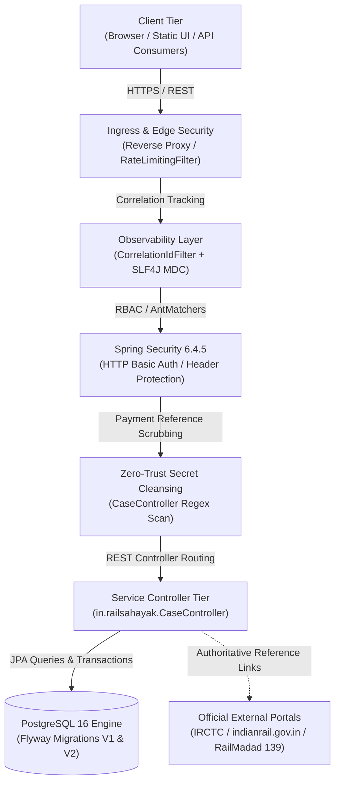
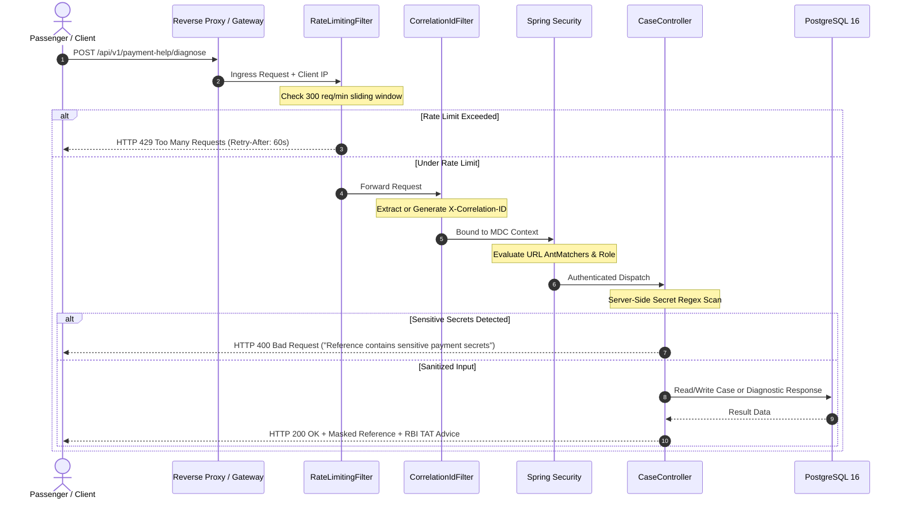
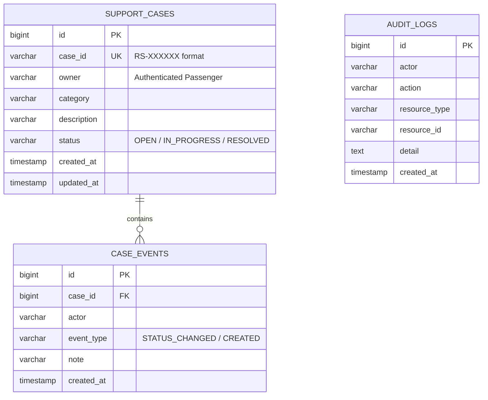

# RailSahayak — Technical Architecture & System Engineering

## 1. Architectural Overview

RailSahayak is engineered as a high-reliability, modular pre-triage and passenger guidance service. It sits logically upstream of authoritative Indian Railways digital services (IRCTC, CRIS PRS, CRIS NTES, and RailMadad), providing rapid procedural translation, statutory rule explanation, zero-trust payment triage, and structured local support case management.

---

## 2. Multi-Tier Component Stack

| Layer | Component | Version / Spec | Operational Role & Invariant |
| :--- | :--- | :--- | :--- |
| **Language Runtime** | Eclipse Temurin OpenJDK | Java 21 LTS (64-bit) | Modern long-term support JVM with strict typing and enhanced garbage collection. |
| **Framework** | Spring Boot | 3.4.5 | Enterprise web framework providing dependency injection, JPA repositories, and filter chains. |
| **Edge Defense** | `RateLimitingFilter` | Sliding-window | Limits traffic to 300 req/min per IP with proxy trust validation. Returns HTTP 429 Retry-After. |
| **Observability** | `CorrelationIdFilter` | UUID / MDC | Binds `X-Correlation-ID` to all SLF4J log lines and outgoing HTTP headers. |
| **Security** | Spring Security | 6.4.5 | Role-based URL enforcement (`ROLE_PASSENGER`, `ROLE_ADMIN`) and hardened security headers. |
| **Persistence** | PostgreSQL | 16 Relational | ACID persistence with foreign key constraints, cascaded deletes, and B-tree indexing. |
| **Schema Migration** | Flyway | 10.20.1 | Version-controlled DDL migrations (`V1__create_tables.sql`, `V2__add_performance_indexes.sql`). |
| **Frontend** | Embedded Static Assets | HTML5 / CSS3 / Vanilla JS | Served from `src/main/resources/static/index.html`. Zero external runtime dependencies. |

---

## 3. Request Pipeline & Ingress Execution Sequence

---

## 4. Database Schema & Relational Integrity

The persistence tier consists of three core relational tables governed by Flyway migrations:

1. **`support_cases`**: Core passenger case entity. Contains generated `RS-XXXXXX` tracking ID, authenticated owner username, category, description, and status (`OPEN`, `IN_PROGRESS`, `RESOLVED`).
2. **`case_events`**: Immutable timeline events appended on each case lifecycle transition. Enforces foreign key constraint to `support_cases.id` with `ON DELETE CASCADE`.
3. **`audit_logs`**: Administrative governance trail capturing administrative actions, timestamps, actor username, and investigation notes.

---

## 5. Architectural Boundaries & Non-Goals

To maintain rigorous institutional integrity, RailSahayak explicitly defines its architectural boundaries:

- **No Live PRS Queries:** PNR guidance utilizes offline deterministic zone-digit heuristics and commercial rule dictionaries; it does not issue live queries against CRIS PRS databases.
- **No Direct Financial Transactions:** The application never executes bank transfers, ticket payments, or direct card refunds; it provides plain-language explanations of the Reserve Bank of India (RBI) Turnaround Time (TAT) framework.
- **No Emergency Grievance Replacement:** RailSahayak provides guidance and triage; passengers requiring physical onboard intervention or medical assistance are routed to RailMadad 139.
