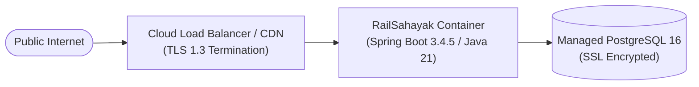

# RailSahayak — Deployment & Operations Guide

## 1. Prerequisites & System Requirements

| Component | Minimum Version | Recommended / Tested |
| :--- | :--- | :--- |
| **Java Development Kit (JDK)** | OpenJDK 21 LTS | Eclipse Temurin 21.0.6 (64-bit) |
| **Build Tool** | Apache Maven 3.9+ | Maven 3.9.9 / 3.10.0 |
| **Database** | PostgreSQL 15+ | PostgreSQL 16.15 |
| **Container Engine** | Docker Engine 24+ | Docker Desktop 28.0+ |
| **Operating System** | Windows 10/11, Ubuntu 22.04+, macOS | Windows 11 64-bit |

---

## 2. Local Windows Setup (Native Service)

### Step 1: Start PostgreSQL
Ensure PostgreSQL 16 is running on `localhost:5432` with a database named `railsahayak`:
```sql
CREATE USER railsahayak WITH PASSWORD 'railsahayak_dev_only';
CREATE DATABASE railsahayak OWNER railsahayak;
GRANT ALL PRIVILEGES ON DATABASE railsahayak TO railsahayak;
```

### Step 2: Configure Environment Variables
Copy `.env.example` to `.env` or set environment variables in your terminal:
```powershell
$env:PORT = "8081"
$env:DB_URL = "jdbc:postgresql://localhost:5432/railsahayak"
$env:DB_USERNAME = "railsahayak"
$env:DB_PASSWORD = "railsahayak_dev_only"
```

### Step 3: Run Automated Test Suite
```powershell
mvn clean test
```
All 29 integration tests should pass in under 10 seconds.

### Step 4: Launch the Spring Boot Application
```powershell
mvn spring-boot:run
```
The application will start on `http://localhost:8081/`. Access the embedded frontend at `http://localhost:8081/index.html`.

---

## 3. Containerized Deployment (Docker Compose)

The repository includes a multi-stage `Dockerfile` and a production-ready `docker-compose.yml` that provisions both the backend application and a persistent PostgreSQL database:

```bash
# Build and launch all services
docker compose up -d --build

# View real-time logs
docker compose logs -f app

# Check service health
docker compose ps
```

Health checks automatically monitor `http://localhost:8081/api/v1/health` and report service status.

---

## 4. Cloud Deployment (Render / Railway / Cloud Run)

### Deployment Architecture


### Environment Variables for Production Cloud
Configure the following environment variables in your hosting provider's dashboard:

| Variable | Recommended Value / Format | Purpose |
| :--- | :--- | :--- |
| `PORT` | Auto-assigned by host (e.g. `10000`, `8080`) | HTTP listen port |
| `DB_URL` | `jdbc:postgresql://<host>:<port>/<dbname>?sslmode=require` | Managed PostgreSQL connection string |
| `DB_USERNAME` | `<db_username>` | Database user |
| `DB_PASSWORD` | `<secure_db_password>` | Database password |
| `DEMO_PASSENGER_PASSWORD`| `<strong_random_password>` | Override default evaluation password |
| `DEMO_ADMIN_PASSWORD` | `<strong_random_password>` | Override default admin password |
| `RAILSAHAYAK_RATE_LIMIT_TRUST_FORWARDED_FOR` | `true` | Enable proxy IP extraction |
| `RAILSAHAYAK_RATE_LIMIT_TRUSTED_PROXIES` | `<host_load_balancer_ip_range>` | Whitelist host reverse proxies |

### Flyway Migrations on Startup
Flyway runs automatically during Spring Boot application startup, applying `V1__create_tables.sql` and `V2__add_performance_indexes.sql` to initialize the database schema without manual DDL execution.

### Health Check Path
- **Path:** `/api/v1/health`
- **Method:** `GET`
- **Expected Status:** `HTTP 200 OK`
- **Expected Response Payload:** `{"status":"UP", ...}`
