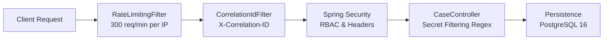

# RailSahayak — Security Architecture & Governance Invariants

## 1. Threat Model & Security Posture

RailSahayak operates as a public-facing pre-triage advisory layer. Its security architecture is designed to address five principal threat vectors:

1. **Denial of Service (DoS) & Scraper Flooding:** Mitigated by `RateLimitingFilter`.
2. **Reverse Proxy Header Spoofing:** Mitigated by strict IP verification and disabled forwarded header trust.
3. **Accidental Credential Ingestion:** Mitigated by zero-trust regex secret filtering in payment triage.
4. **Information Leakage via Errors:** Mitigated by `GlobalExceptionHandler`.
5. **Unauthorized Privilege Escalation:** Mitigated by Spring Security role-based access control.

---

## 2. Security Invariants & Defensive Controls



### 2.1 Sliding-Window Edge Rate Limiting

- **Component:** `RateLimitingFilter.java`
- **Order:** `Ordered.HIGHEST_PRECEDENCE + 1` (executes before Spring Security filter chain)
- **Invariant:** Clients are bounded by an atomic in-memory window of 300 requests per rolling 60-second interval. Exceeding requests immediately return `HTTP 429 Too Many Requests` with a `Retry-After: 60` response header.
- **Proxy Verification:** `X-Forwarded-For` is inspected **only** when `railsahayak.rate-limit.trust-forwarded-for=true` and the direct socket address matches a documented trusted proxy. Untrusted remotes attempting to forge `X-Forwarded-For` are evaluated strictly against their direct network address.

### 2.2 Server-Side Sensitive Secret Cleansing

- **Component:** `in.railsahayak.CaseController`
- **Scope:** `POST /api/v1/payment-help/diagnose` (`PaymentDiagnoseRequest.reference()`)
- **Regex Pattern:**
  ```regex
  (?i)\b(\d{4}[- ]?){3}\d{4}\b|\b(cvv|otp|pin|password)\b
  ```
- **Behavior:**
  - Evaluates the raw input reference before database or diagnostic handling.
  - Matches 16-digit card patterns (e.g. `4111 2222 3333 4444`) or sensitive keywords (`cvv`, `otp`, `pin`, `password`).
  - Aborts request immediately with `HTTP 400 Bad Request` and logs a warning with the request correlation ID (`SENSITIVE_INPUT_BLOCKED`).
- **Residual Risk & Production Hardening:** Free-text descriptions in the support case endpoint (`POST /api/v1/cases`) accept narrative text without regex secret filtering. Extending secret scanning to all user input forms represents an identified production requirement.

### 2.3 Zero-Leakage Error Handling

- **Component:** `GlobalExceptionHandler.java`
- **Annotation:** `@RestControllerAdvice`
- **Behavior:**
  - Intercepts all uncaught `java.lang.Exception` instances.
  - Full Java stack traces and SQL exception details are logged internally with the request correlation ID.
  - Clients receive an opaque, sanitized JSON response containing:
    ```json
    {
      "status": 500,
      "error": "INTERNAL_SERVER_ERROR",
      "message": "An unexpected error occurred. Please quote correlation ID for support.",
      "correlationId": "0d035415-4608-410c-9907-6f6eb80aee89"
    }
    ```
  - Internal package names, database table structures, and JVM details are never emitted.

### 2.4 Hardened HTTP Security Headers

Spring Security filter chain automatically injects defensive HTTP response headers:
- `X-Content-Type-Options: nosniff` — Prevents MIME-type confusion attacks.
- `X-Frame-Options: SAMEORIGIN` — Prevents UI redressing and clickjacking.
- `Referrer-Policy: strict-origin-when-cross-origin` — Restricts referrer leakage on navigation.
- `Permissions-Policy: camera=(), microphone=(), geolocation=()` — Disables unnecessary browser capabilities.

---

## 3. Digital Personal Data Protection (DPDP) Act, 2023 Alignment

| DPDP Principle | RailSahayak Architectural Implementation | Status |
| :--- | :--- | :--- |
| **Purpose Limitation** | Data collected strictly for passenger advisory guidance; never repurposed for marketing or commercial profiling. | Aligned by Design |
| **Data Minimisation** | Secret regex blocks payment cards/PINs; payment references masked (e.g. `UPI****098`); only essential case data stored. | Implemented in Prototype |
| **Storage Limitation** | Support cases and audit logs retained for operational triage; automated TTL purging planned for production deployment. | Identified Production Requirement |
| **Integrity & Confidentiality** | Role-based URL protection; standard PostgreSQL persistence; managed cloud storage encryption (KMS) planned for staging. | Aligned by Design |
| **Accountability & Auditing** | Dual audit logging capturing actor, timestamp, correlation ID, and state transitions in `audit_logs` and `case_events`. | Implemented in Prototype |
