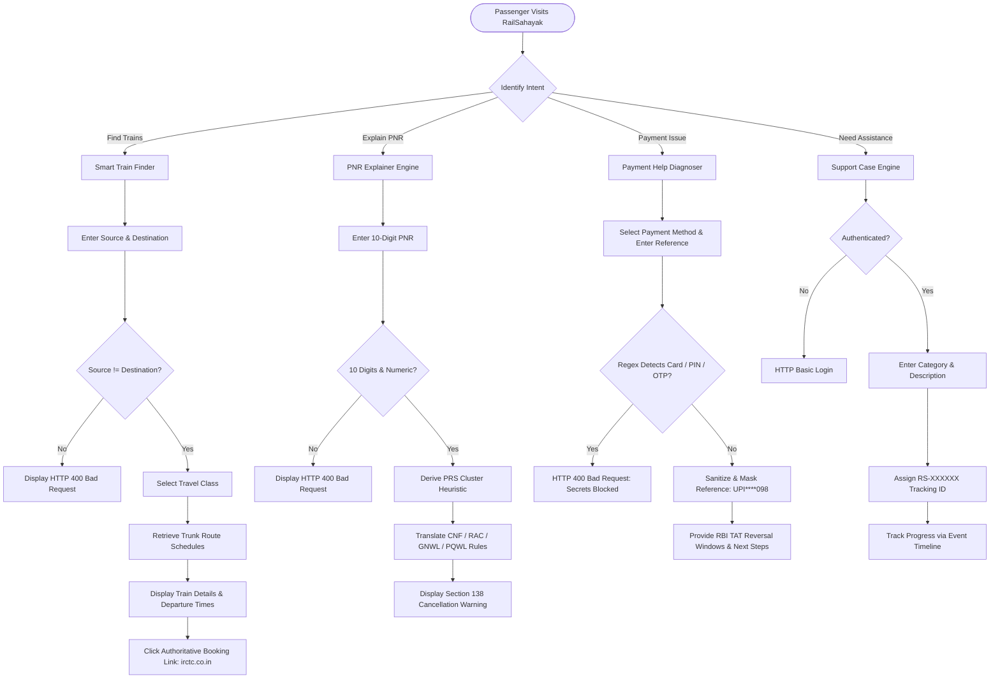
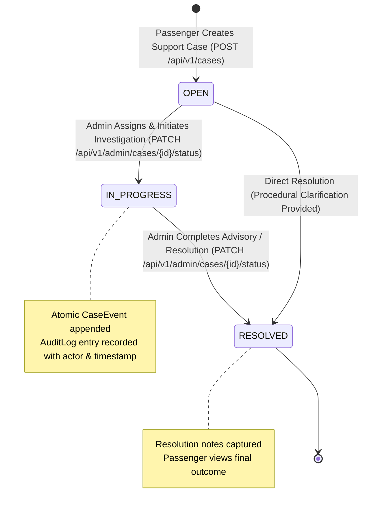
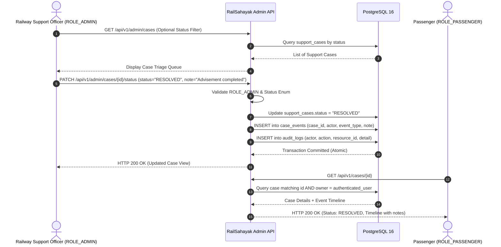

# RailSahayak — End-to-End User Journeys & Workflows

## 1. Passenger Journey Workflow

RailSahayak guides travelers through routine railway inquiries using transparent procedural workflows that minimize friction while maintaining authoritative external boundaries.

---

## 2. Complaint & Case Lifecycle State Machine

Support cases in RailSahayak follow a strictly governed lifecycle. Status transitions are restricted to staff holding `ROLE_ADMIN` and generate immutable audit log records.

---

## 3. Administrative Triage & Dual Audit Workflow

---

## 4. Payment Diagnostic & Settlement Guidance Workflow

When a passenger experiences a failed transaction or payment deduction without ticket confirmation:

1. **Input Submission:** Passenger selects the payment mode (UPI, Debit/Credit Card, Net Banking) and issue type (`deducted`, `pending`, `failed`), providing a transaction reference.
2. **Defensive Scrubbing:** The system evaluates the reference string with regex. If card PANs, PINs, OTPs, or passwords are detected, the request is immediately aborted with HTTP 400, protecting citizen financial secrets.
3. **Reference Masking:** Safe reference strings are masked (e.g. `UPI****098`).
4. **Regulatory Advice:** The system returns tailored advice based on Reserve Bank of India (RBI) Circular `DPSS.CO.PD No.629/02.01.014/2019-20`:
   - **UPI:** Auto-reversal within **T+1 business day**.
   - **Wallets / PPIs:** Auto-reversal within **T+1 calendar day**.
   - **E-Commerce / Card Transactions:** Auto-reversal within **T+5 calendar days**.
   - **Compensation:** ₹100 per day payable to customer if reversal exceeds TAT.
   - **Duplicate Booking Warning:** Passengers are explicitly cautioned against immediate re-booking attempts during Tatkal surge windows to prevent repeated bank deductions.
